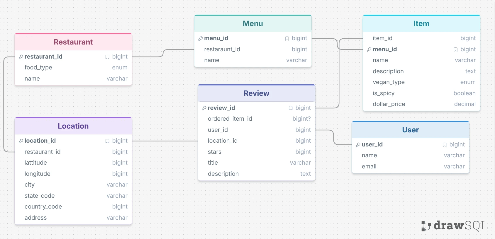

# Project Report
The purpose of this database is to store reviews and menus for different restaurants. The idea is that you can chat with an agent about what food is nearby and it can give you good recommendations based on user reviews, location, and preferences.



## Sample Questions and Results

### Worked example

**Question:** What is the highest-rated restaurant in Albuquerque? Include its average rating and number of reviews.

```sql
SELECT r.name, ROUND(AVG(rv.stars), 2) AS average_rating,
       COUNT(rv.review_id) AS review_count
FROM Restaurant r
JOIN Location l ON l.restaurant_id = r.restaurant_id
JOIN Review rv ON rv.location_id = l.location_id
WHERE l.city = 'Albuquerque' AND l.state_code = 'NM'
GROUP BY r.restaurant_id, r.name
ORDER BY average_rating DESC, review_count DESC
LIMIT 1;
```

**Response:** Trattoria Sol is the highest-rated restaurant, with 4.83 stars across 6 reviews.

### Failure example to test

**Question:** Which restaurant is open right now?

```sql
SELECT name FROM Restaurant WHERE is_open = 1;
```

**Expected result:** This query fails with `no such column: is_open`. The schema does not store restaurant hours or current open status, so this question cannot be answered from the available data. This is an illustrative failure case, not a recorded model run.

### Six additional example questions

1. Which vegan menu items in Albuquerque cost less than $15?
2. What are the three most-reviewed restaurants, and what are their average ratings?
3. Which vegan menu items have an average review rating of at least 4 stars?
4. Which Italian restaurant has the highest average review rating?
5. Which restaurants offer both vegan and vegetarian menu options?
6. Which spicy vegan menu items are the least expensive?

## Prompting Strategies

I tried both zero-shot and single domain double shot questions. Of the few questions I asked, I noticed very little if any quality difference in the AI answers. I imagine with a larger database, single domain double shot may give you some higher-quality results, but for the simple schema I created, the tables are self-explanatory enough for zero-shot to do the trick.